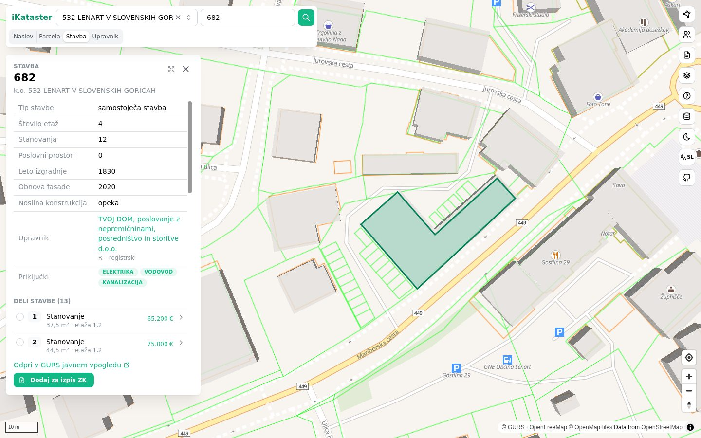
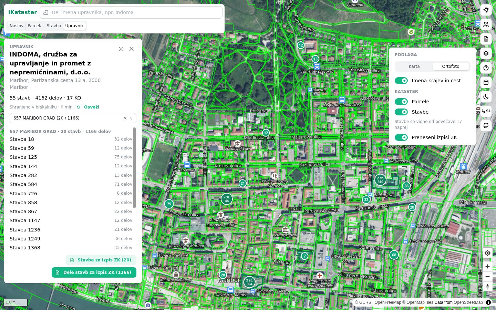
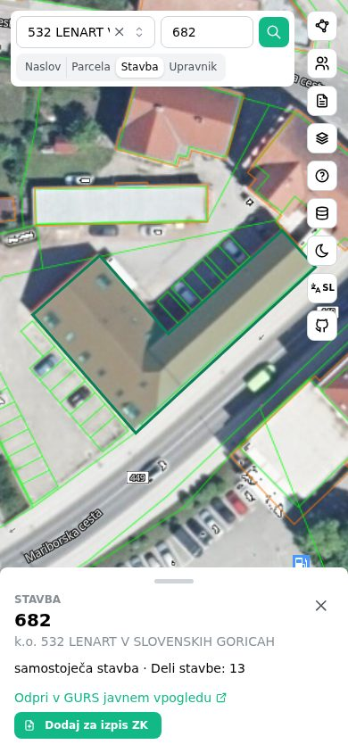
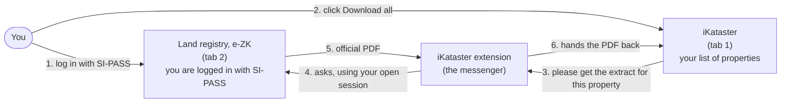

# iKataster

**Slovenian real estate on a map, free, in your browser: [ikataster.si](https://ikataster.si)**

Look up any parcel, building, building part or building manager (*upravnik*) in Slovenia, see its GURS value and past sales and rentals, and, with the companion browser extension, download official land-registry extracts (e-ZK) through your own SI-PASS login and turn them into clear tables of owners, mortgages and easements.

No account and nothing to install to get started: just open [ikataster.si](https://ikataster.si). Everything you save stays on your device. The interface is in Slovenian, with an English option.



| Building manager portfolio on the aerial photo | Phone |
|---|---|
|  |  |

> **Slovensko:** iKataster je brezplačna spletna aplikacija za pregled parcel, stavb, delov stavb in upravnikov na zemljevidu, z javnimi podatki GURS (posplošena vrednost, prodaje in najemi iz ETN). Na voljo na [ikataster.si](https://ikataster.si). Z razširitvijo za brskalnik prek vaše prijave SI-PASS prenaša izpiske iz zemljiške knjige in iz njih izpiše lastnike, hipoteke in služnosti. Brez strežnika in brez računa: vsi podatki ostanejo v vašem brskalniku.

If iKataster is useful to you, a ⭐ on GitHub helps other people find it.

**Contents**

- Part 1, for users: [What you can do](#what-you-can-do) · [How iKataster connects to the land registry](#how-ikataster-connects-to-the-land-registry) · [Privacy](#privacy) · [Data sources](#data-sources)
- Part 2, for developers and self-hosting: [How it works](#how-it-works) · [Repository layout](#repository-layout) · [Getting started](#getting-started) · [Hosting it yourself](#hosting-it-yourself) · [Building the data](#building-the-data)

---

# Part 1: Using iKataster

## What you can do

- **Search** by address, parcel (cadastral municipality + number), building, or building manager (by name, initials, office address or town). If you search in the wrong tab, iKataster tells you where it found the match.
- **Parcel details**: area, municipality, land use, intended use, spatial planning unit (EUP, with a link to the municipal plan), soil quality (*boniteta*), buildings on the parcel and GURS value.
- **Building details**: attributes, connections, and every building part with its use, area, floor, entrance, value and building manager.
- **Prices**: GURS mass-appraisal value (*posplošena vrednost*), recorded sales and rentals (ETN), and an estimate based on comparable sales in the same area.
- **Building managers**: see every building a manager looks after on the map.
- **Map**: street map or aerial photo (GURS orthophoto, including historical years back to 1990), with parcels and building outlines on top.
- **Area selection and lists**: draw a polygon to collect all the parcels or buildings inside it, or import a CSV/XLSX list.
- **Land-registry extracts** (on a computer, with the extension):
  - download many e-ZK extracts in one go;
  - see owners, shares, mortgages, easements and pending changes;
  - re-check later to see what changed;
  - group extracts into saved lists (e.g. one per building or client), filter by KO, number or download day, and export them to Excel/CSV or to a ZIP that includes the PDFs.
- **Works on a phone** and can be added to the home screen. You can share a link to any parcel or building.
- **Backup**: save and restore all your local data as one file.

## How iKataster connects to the land registry

*Plain-language overview. You don't need any technical knowledge.*

iKataster can't log into the land registry for you, and it never sees your password. You log in yourself, the normal way, and the small iKataster browser extension then passes requests between the two tabs.

Install the extension from the [Chrome Web Store](https://chromewebstore.google.com/detail/ebmmbpmcpgdjipkcjaikgpkgpcmekhmp) (Chrome and Edge).



### Step by step

1. **Install the extension once** on a computer: in Chrome or Edge from the [Chrome Web Store](https://chromewebstore.google.com/detail/ebmmbpmcpgdjipkcjaikgpkgpcmekhmp). For Firefox the app shows manual steps (document icon at top right → *Navodila za namestitev*).
2. **Open the land registry** ([e-Sodstvo, e-ZK](https://esodisce.si/)) in another tab and **log in with your SI-PASS** as usual. Keep that tab open.
3. **In iKataster, add properties to the download list** (tab *Za prenos* under the extracts button) (one by one, by drawing an area, or by importing a spreadsheet).
4. **Click download.** For each property the extension asks the land-registry tab for the official extract, the same way you would by hand, and gives the PDF back to iKataster.
5. **iKataster reads the PDFs** and shows owners, shares, mortgages and easements in clear tables that you can filter and export.

### Good to know

| Question | Answer |
|---|---|
| Does iKataster see my SI-PASS password? | No. You only enter it on the official SI-PASS/e-Sodstvo pages. |
| Where are my extracts stored? | Only in your browser, on your computer. Nothing is uploaded to an iKataster server, because there isn't one. |
| Why do I need the extension? | For security, a website isn't allowed to read another website's tab. The extension is the permitted bridge, and it only talks to iKataster and e-ZK. |
| What if I log out or the session expires? | Downloads pause and the app asks you to log in to e-ZK again, then continue. |
| Is there a limit? | Yes. e-Sodstvo allows about 400 extracts per user per day; the app counts them and stops before the limit. |
| Does it work on a phone? | Searching and the map do. Bulk downloading needs the extension, so use a computer; on a phone you can upload PDFs you already have. |

## Privacy

- No iKataster server sees your searches or extracts. The app is a set of static files: your browser downloads the cadastral data files and map tiles, and does everything else locally.
- Your lists, extracts and saved lists live only in your browser (IndexedDB). Use *Podatki → Varnostna kopija* to back them up.
- The extension talks only to iKataster and to the e-ZK portal, inside your own logged-in browser session.
- iKataster never publishes owner data. You search by property, never by a person's name.

## Data sources

All GURS data is used under the GURS terms of use, [CC BY 4.0](https://creativecommons.org/licenses/by/4.0/) (*Pogoji uporabe* on [e-prostor.gov.si](https://www.e-prostor.gov.si/dostopi/javni-dostop/)). Source attribution as required by GURS: **Geodetska uprava Republike Slovenije**, data type, and the date of the data:

- Cadastre, buildings, building parts, addresses, spatial units and building managers: Geodetska uprava Republike Slovenije, Kataster nepremičnin, Register prostorskih enot, Register naslovov. iKataster keeps a weekly copy of the GURS open-data exports and serves it as static files; the date of the data is in `mirror/index.json`. Ownership files are not used.
- Current and historical orthophoto: Geodetska uprava Republike Slovenije, Digitalni ortofoto (DOF025, DOF050), from the live GURS WMS.
- Mass-appraisal values: Geodetska uprava Republike Slovenije, Evidenca vrednotenja (values only, no ownership data). Date: `date` in `index.json` on the [`data` branch](https://github.com/ibracic/ikataster/tree/data), also shown next to every value.
- Sales and rentals: Geodetska uprava Republike Slovenije, Evidenca trga nepremičnin (ETN). Contains no information on the parties to a deal. Date: `date` in `tx/index.json` on the same branch.
- Basemap: [OpenFreeMap](https://openfreemap.org/), © OpenStreetMap contributors.
- Land-registry extracts: [e-ZK on e-Sodstvo](https://esodisce.si/), downloaded by the user through their own SI-PASS session.

iKataster is an independent project and is not affiliated with GURS or the Slovenian judiciary. Data is provided as is; always check official sources for legal purposes.

---

## Contact

Questions, bugs or suggestions: [info@ikataster.si](mailto:info@ikataster.si) or a [GitHub issue](https://github.com/ibracic/ikataster/issues).

# Part 2: For developers and self-hosting

## How it works

- **No backend.** `apps/web` builds to a plain static site. All state is kept in the browser (IndexedDB via Dexie).
- **Cadastral copy.** A weekly job converts the GURS national open-data exports into static files under `/mirror`:
  - vector tiles for parcels and buildings;
  - one JSON file per cadastral municipality (parcels, buildings, parts, land use, EUP, municipality);
  - search shards for addresses and building managers.

  The app answers every lookup from these files, which makes it fast and lets it work outside Slovenia. Only the orthophoto tiles come live from GURS. File format: [docs/mirror-format.md](docs/mirror-format.md).
- **Values and sales** are per-KO JSON files on the `data` branch of this repository, rebuilt weekly.
- **Extension.** A Manifest V3 extension relays requests between the app tab and the logged-in e-ZK tab. The app parses the returned PDFs with pdf.js. The protocol is in `packages/bridge`.
- **Offline.** A service worker caches the app and aerial tiles, and a cadastral municipality can be pinned for offline use.

## Repository layout

| Path | What it is |
|---|---|
| `apps/web` | The web app (React, React Router in library mode, Mantine, MapLibre GL, Dexie) |
| `packages/bridge` | Message protocol between the app and the extension |
| `packages/extension` | Manifest V3 extension for Chrome, Edge and Firefox |
| `scripts/mirror` | Weekly cadastral copy (tiles, per-KO files, search shards) |
| `scripts/valuations`, `scripts/transactions` | Weekly values and ETN files for the `data` branch |

## Getting started

Requirements: Node.js 22+.

```bash
cp .env.example .env      # set IKATASTER_ORIGINS to your hosting origin(s)
npm install
npm run dev               # app on http://localhost:5173
npm test                  # all unit and flow tests
npm run build             # production build of the app
npm run build -w @ikataster/extension   # extension zips in packages/extension/dist
```

`IKATASTER_ORIGINS` is a comma-separated list of the https origins where you host the app (`http://localhost` and `http://127.0.0.1` are always allowed for development). It is injected at build time into the extension (which pages it may talk to) and the app's bridge allowlist, so no hosting domain is hard-coded in the source.

## Hosting it yourself

### Run with Docker

```bash
docker compose up -d --build
```

The image runs the tests, builds the app and the extension, and serves everything with nginx on `127.0.0.1:3119`. Put your own reverse proxy with TLS in front of it.

Any static host works too: `apps/web/dist` is a plain static site, and `apps/web/public/_headers` carries the same security headers for hosts that read that file (Cloudflare Pages, Netlify). The public instance at ikataster.si is hosted this way, on Cloudflare Pages.

By default the app reads the cadastral copy from `/mirror` on its own origin, and values and sales from this repository's `data` branch (override with `VITE_IKATASTER_VALUES_URL`). If you host it yourself, build the copy as described below and put it in `dist/mirror`.

### Installing the extension

Chrome and Edge users install the extension from the [Chrome Web Store](https://chromewebstore.google.com/detail/ebmmbpmcpgdjipkcjaikgpkgpcmekhmp). The built app also serves the extension zips under `/extension/` for manual installs. In the app open *Izpisi iz zemljiške knjige → Za prenos → Navodila za namestitev* for step-by-step instructions (load unpacked in Chrome/Edge, temporary add-on in Firefox). After installing, reload the app tab once.

## Building the data

You need Python 3, GDAL (`ogr2ogr`) and [tippecanoe](https://github.com/felt/tippecanoe), plus about 8 GB of RAM and 20 GB of free disk.

```bash
scripts/mirror/build.sh <work-dir> <site-dir> [--force]   # cadastral copy, a few hours; skips if the GURS data is unchanged
python3 scripts/valuations/build.py --help                 # mass-appraisal values per KO
python3 scripts/transactions/build.py --help               # ETN sales and rentals per KO
```

`build.sh` downloads the GURS national exports (never the ownership files) and converts them. It then writes the tiles and per-KO files and validates them with `check_format.py` against `scripts/mirror/format.json`. The new site is swapped in only if every check passes.

## License

[MIT](LICENSE) © Igor Bračič
